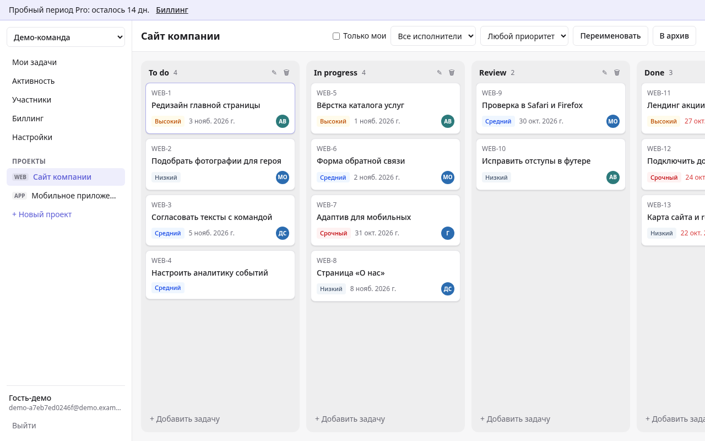
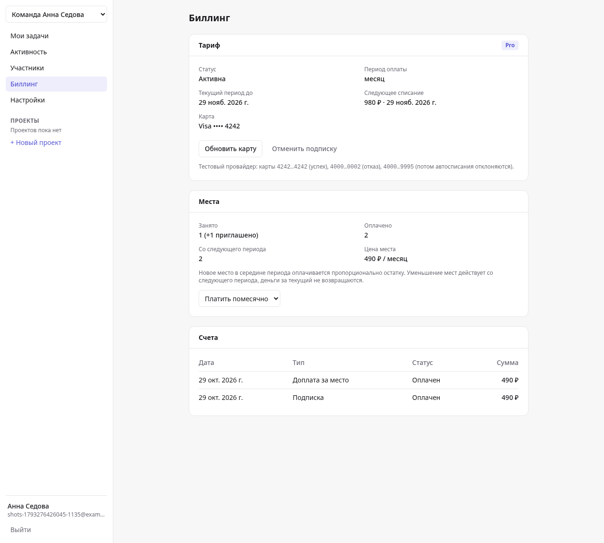
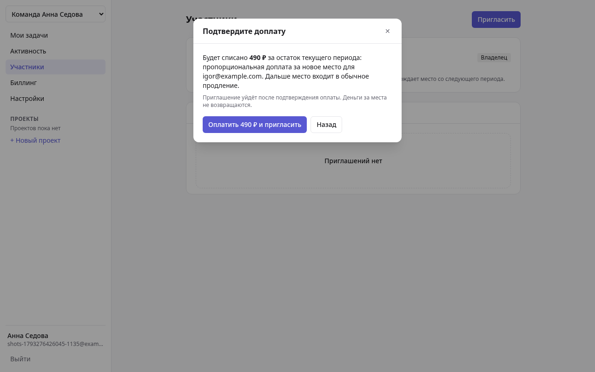
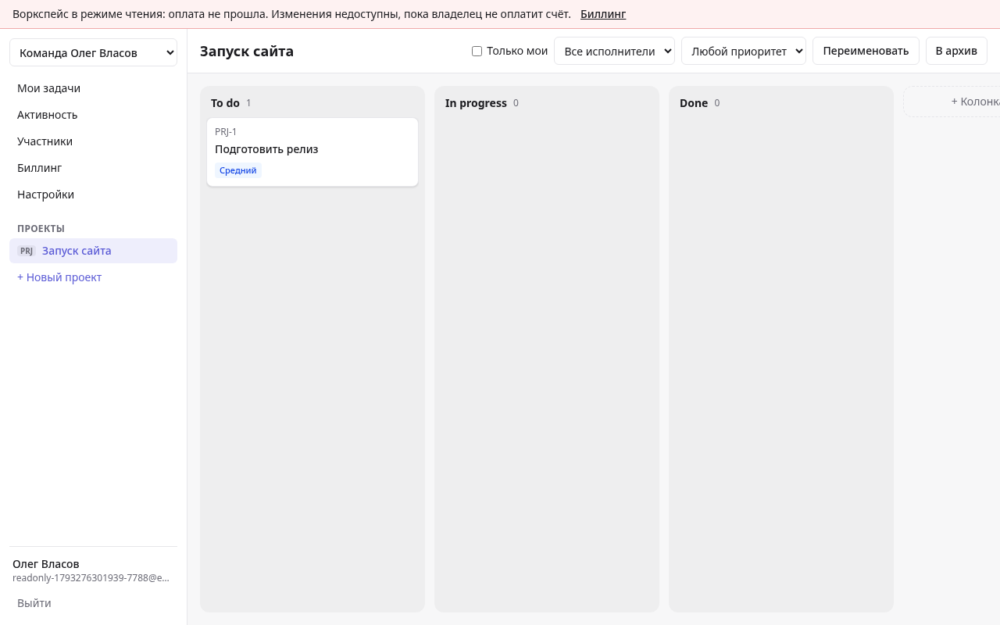
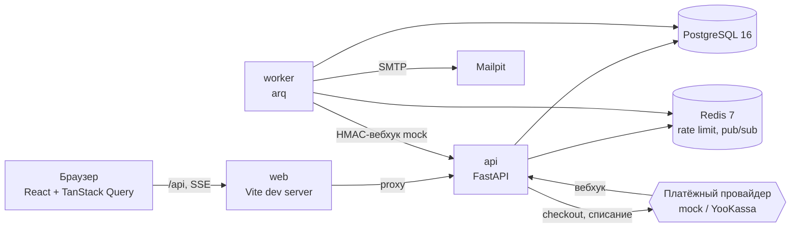
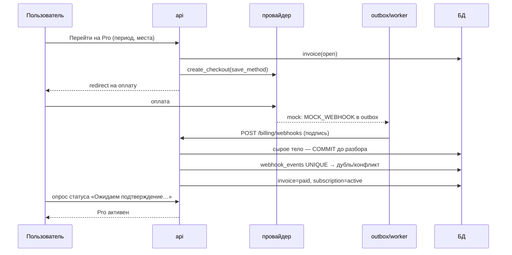
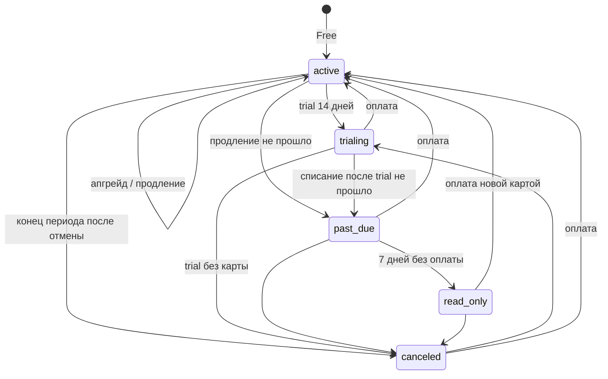

# Crewboard

[](https://github.com/dyomegorin-art/crewboard/actions/workflows/ci.yml)

Таск-трекер для команд с подпиской «за место»: канбан, воркспейсы с ролями, тарифы Free / Pro, пропорциональные доплаты, продления и dunning на вебхуках.

> **Учебный портфолио-проект. Все данные вымышлены, платежи тестовые.**



## Зачем

Канбан здесь — «тело» продукта, сделанное аккуратно и без излишеств. Главное, что проект показывает:

- **корректную авторизацию**: короткий access-JWT в памяти, refresh в httpOnly-cookie с ротацией и обнаружением повторного использования, сброс пароля, OAuth;
- **мультитенантность**: данные одного воркспейса недоступны из другого на уровне API *и* базы (составные внешние ключи), права по ролям;
- **биллинг по местам с вебхуками**: логика подписок своя (`backend/app/billing`), платёжный провайдер только проводит платежи; вебхуки идемпотентны, продления и dunning переживают падения благодаря outbox.

## Быстрый старт

Нужны Docker и Docker Compose.

```bash
cp .env.example .env
docker compose up --build
```

Миграции и seed применяются автоматически при старте. Ключи внешних сервисов не нужны: платежи — встроенный mock-провайдер, почта — Mailpit, вход через GitHub выключен.

| Что | Адрес |
|---|---|
| Приложение | <http://localhost:5173> |
| Swagger (API) | <http://localhost:8000/docs> |
| Mailpit (письма) | <http://localhost:8025> |

**Демо-вход.** На лендинге нажмите «Попробовать без регистрации»: создаётся свежий воркспейс (3 участника-бота, 2 проекта, 25 задач, активный пробный период Pro). Демо-данные удаляются через 24 часа.

**Постоянные аккаунты** (создаёт seed, только при `ENV=local`), пароль у всех `crewboard-demo`:

| Email | Роль в «Acme Studio» |
|---|---|
| `owner@acme-studio.example.com` | owner |
| `admin@acme-studio.example.com` | admin |
| `member@acme-studio.example.com` | member |

**Тестовые карты** (страница `/mock-checkout/…`):

| Номер | Что произойдёт |
|---|---|
| `4242 4242 4242 4242` | успех |
| `4000 0000 0000 0002` | отказ |
| `4000 0000 0000 9995` | оплата проходит, а следующие автосписания отклоняются — для демонстрации dunning |

**Сдвиг времени** (только `ENV=local`): `curl -X POST localhost:8000/api/dev/advance-clock -H 'content-type: application/json' -d '{"days": 31}'` — воркер увидит конец периода, создаст счёт на продление и т. д. `POST /api/dev/reset-clock` возвращает реальное время. При `ENV=staging|production` приложение с включённым `DEV_ENDPOINTS` не стартует.

### Команды

```bash
make up          # docker compose up --build -d
make down
make test        # pytest против настоящих Postgres и Redis + покрытие
make lint        # ruff, ruff format --check, mypy strict, eslint, tsc
make seed        # повторно запустить seed (идемпотентен)
make e2e         # Playwright против поднятого compose
make screenshots # скриншоты в docs/img
```

## Скриншоты

| Биллинг | Доплата за место |
|---|---|
|  |  |



## Архитектура



### Апгрейд на Pro



### Статусы подписки



Подробнее — в [docs/ARCHITECTURE.md](docs/ARCHITECTURE.md), журнал решений — в [docs/DECISIONS.md](docs/DECISIONS.md).

## Возможность → Как сделано

| Возможность | Как сделано |
|---|---|
| Авторизация | argon2 (в потоке, не блокирует loop), access-JWT 15 мин в памяти фронтенда; refresh — непрозрачная строка, в БД только SHA-256 |
| Ротация токенов | каждый `/auth/refresh` выдаёт новый refresh и отзывает старый (`replaced_by_id`); предъявлен отозванный → отзывается всё семейство `family_id`, 401. Тест `test_refresh_reuse_detection_revokes_family` |
| CSRF | refresh-cookie доступна только `/api/auth/*`, `SameSite=Lax`, плюс обязательный заголовок `X-Requested-With` |
| Сброс пароля | одноразовый токен на 30 минут (хэш в БД), одинаковый ответ для любого email, после сброса отзываются все сессии |
| OAuth GitHub | authorization code + `state` в подписанной cookie; привязка только к *подтверждённому* локальному email; выключен без ключей (404) |
| Тенантность | `workspace_id` во всех таблицах; не участник — 404, нет права — 403 + `access_denied` в логе; составные FK запрещают кросс-тенантные ссылки в БД |
| Права | словарь `PERMISSIONS` (owner / admin / member / guest), зависимость `require(permission)` |
| Тарифы и лимиты | единственный источник — `billing/plans.py`; проверки в сервисном слое, коды `plan_limit_*` → модалка «Перейдите на Pro» |
| Proration | `цена × остаток_секунд / секунд_периода`, `Decimal`, `ROUND_HALF_UP`, целые копейки; предпросмотр суммы и подтверждение до приглашения |
| Места и конкуренция | `SELECT … FOR UPDATE` на подписке: параллельные приглашения не считают одно место дважды (тест) |
| Идемпотентность вебхуков | сырое тело коммитится до разбора; `UNIQUE(provider, event_id)`; тот же id с другим содержимым → 409 + `SystemIssue`; тест на 6 параллельных доставок |
| Автомат статусов | одна функция `transition()` с явной таблицей переходов; недопустимый переход → исключение + `SystemIssue` |
| Продление | cron раз в минуту → `RENEW_SUBSCRIPTION`; идемпотентность: `dedupe_key` + частичный UNIQUE на счёт продления + ключ списания `renewal:{ws}:{period_start}` |
| Dunning | повторы через 1, 3, 5 дней, на 7-й — `read_only`: все изменяющие эндпоинты отвечают `402 workspace_read_only` (одна зависимость), чтение работает |
| Outbox | `FOR UPDATE SKIP LOCKED`, backoff 30→900 с, до 5 попыток, `PermanentCommandError`, `FAILED` + `SystemIssue`; время инжектируется |
| Real-time | Redis pub/sub после коммита → SSE; доступ по 60-секундному билету; доска второго пользователя обновляется без перезагрузки |
| Даунгрейд | лишние проекты архивируются (read-only), данные не удаляются |
| Экспорт | CSV потоком (`StreamingResponse`), защита от CSV-инъекций |

## Тесты и качество

- **Backend**: 190+ тестов на настоящих PostgreSQL и Redis (отдельные БД), инжектируемые часы без `sleep`; покрытие `app/billing` и `app/api` — выше 90 %.
- **Frontend**: `tsc --noEmit`, ESLint, `vite build`.
- **e2e (Playwright)**: регистрация → письмо в Mailpit → проект и задача → drag-and-drop → апгрейд картой 4242 → приглашение с доплатой; отдельно — отказ картой 0002, лимиты Free, демо-вход и весь dunning со сдвигом часов.
- **CI** (GitHub Actions): backend (ruff, format, mypy, `alembic check`, pytest + coverage), frontend (lint, typecheck, build), e2e (`docker compose up`, Playwright).

## Структура

```
backend/   FastAPI-приложение (app/api, models, services, billing), alembic, tests
frontend/  Vite + React 19 + TS, e2e/ (Playwright)
docs/      ARCHITECTURE.md, DECISIONS.md, img/
```

## Намеренно не реализовано

Честный список того, чего здесь нет:

- **Возвраты и чеки**: нет refund-потока (проверочный платёж 1 ₽ для привязки карты в реальной системе возвращался бы), нет НДС, чеков 54-ФЗ и закрывающих документов.
- **Профиль**: нет экрана смены email / пароля и привязки GitHub к уже созданному аккаунту (ограничения для демо-пользователя заложены в API: у них нет пароля, сброс не отправляется), нет 2FA.
- **Рост мест из биллинга**: места растут только через приглашения; прямой кнопки «купить N мест» нет. Смена роли гость ↔ участник — повторным приглашением.
- **Гости и real-time**: гостям SSE-события не отправляются (нужна проверка доступа к проекту по каждому событию).
- **Продукт трекера**: нет подзадач, меток, вложений, @упоминаний, внутренних уведомлений, пагинации доски (всё в одном ответе — для демо достаточно).
- **YooKassa против настоящего магазина**: адаптер проверен только на фикстурах с замоканным HTTP, реальных вызовов нет.
- **Почта**: письма простые текстовые, без шаблонов и обработки bounce.
- **Frontend unit-тесты**: поведение интерфейса покрыто только e2e.
- **Production-деплой**: нет Dockerfile для сборки статики, reverse-proxy, HTTPS-конфигурации и мониторинга; `validate_startup` лишь отказывается стартовать в небезопасной конфигурации.
