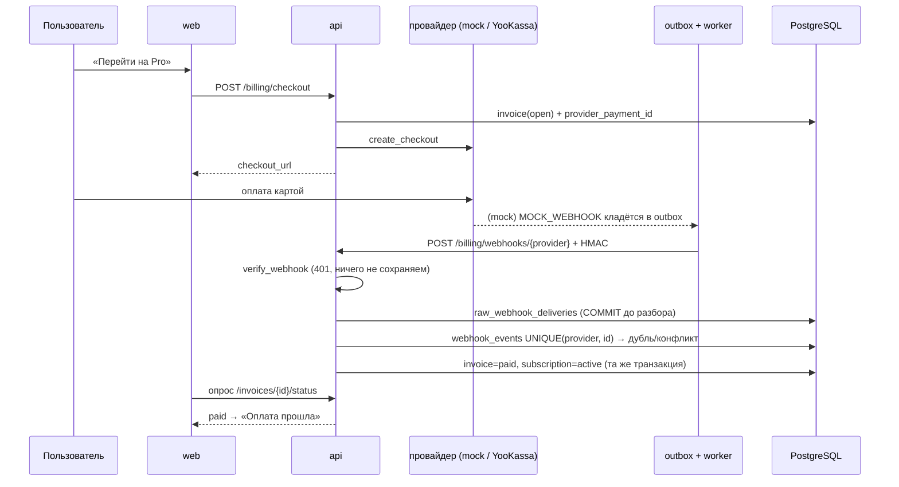
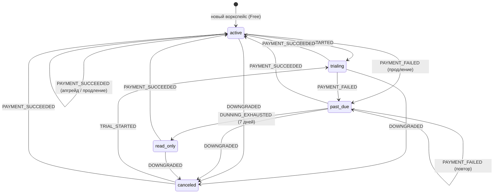

# Архитектура

## Границы модулей

```
backend/app/
  api/         HTTP-слой: роутеры, зависимости (аутентификация, права), схемы запросов/ответов
  models/      SQLAlchemy-модели (user, workspace, project, billing)
  schemas/     pydantic-схемы
  services/    бизнес-логика, не относящаяся к биллингу (задачи, приглашения, демо, аудит)
  billing/     всё про деньги — единственное место, которое знает про тарифы и платежи
    plans.py       тарифы, лимиты, цены, расписание dunning (ЕДИНСТВЕННОЕ место)
    limits.py      применение лимитов: plan_limit_* → HTTP 402
    proration.py   периоды и пропорциональная доплата (Decimal, ROUND_HALF_UP)
    state.py       автомат статусов подписки
    seats.py       учёт мест, расчёт доплаты, резервирование под приглашение
    service.py     trial, апгрейд, события провайдера → состояние, продление, dunning, отмена
    webhooks.py    приём вебхуков (сырое тело → событие → состояние)
    handlers.py    обработчики outbox-команд
    providers/     base (Protocol), mock, yookassa
  outbox.py    универсальный outbox (не знает про биллинг)
  clock.py     часы приложения (системные / со сдвигом из Redis / фейковые в тестах)
  events.py    публикация событий в Redis pub/sub
  worker.py    arq: cron-задачи
```

Зависимости направлены вниз: `api → services / billing → models`. `billing` не импортирует `api`; `services` зовёт `billing` только для лимитов и мест. `outbox` ничего не знает про домен — обработчики регистрируются декоратором `@handler`.

Провайдер платежей скрыт за `PaymentProvider`:

```python
class PaymentProvider(Protocol):
    name: str
    async def create_checkout(self, *, invoice, return_url, save_method) -> CheckoutSession: ...
    async def charge_saved_method(self, *, invoice, method, idempotency_key) -> ChargeResult: ...
    async def verify_webhook(self, raw_body, headers) -> None: ...   # подлинность, WebhookAuthError
    async def parse_webhook(self, raw_body, headers) -> ProviderEvent: ...
```

Всё остальное — подписки, места, доплаты, продления, dunning — наш код. Смена провайдера не затрагивает `service.py`.

## Данные и тенантность

- `workspace_id` есть во всех таблицах содержимого, и им фильтруется **каждый** запрос.
- Составные внешние ключи не дают собрать задачу из частей разных воркспейсов даже в обход API (`tasks(workspace_id, project_id)`, `(workspace_id, status_id)`, `(workspace_id, assignee_id) → memberships`, то же для комментариев, колонок и гостей проекта). Тест `test_database_composite_foreign_keys_block_cross_tenant_rows` пытается их нарушить напрямую.
- На уровне API `get_membership` отвечает 404 для не-участника, `require(permission)` — 403 с записью `access_denied`, `ensure_writable` — 402 в `read_only`.

## Платёжный поток

Состояние подписки меняется **только** в одном месте — `apply_provider_event`, куда ведёт вебхук. Страница возврата лишь опрашивает статус.



### Идемпотентность вебхуков

1. Неподлинный → `401`, **ничего** не сохраняется.
2. Сырое тело и заголовки коммитятся до разбора (`raw_webhook_deliveries`).
3. `UNIQUE(provider, provider_event_id)`: повтор того же содержимого → `200 duplicate`; тот же id с другим содержимым (fingerprint канонического JSON) → `409` + `SystemIssue` + доставка помечена `CONFLICT`.
4. Изменение подписки и счёта — в той же транзакции, что вставка события. Гонку параллельных доставок решает ограничение БД (тест — 6 одновременных доставок, применено ровно одно).
5. Любая необработанная ошибка → доставка `FAILED`, `SystemIssue`, ответ `500` (провайдер повторит), а событие откатывается — повтор пройдёт.

### Автомат статусов



Таблица `TRANSITIONS` покрыта тестом «каждый перечисленный переход допустим, каждый остальной — отвергается».

### Места и доплата

`demand = занятые (owner/admin/member) + активные приглашения платных ролей`. Гости места не занимают.

1. Приглашение берёт `SELECT … FOR UPDATE` на подписке, считает `demand + 1` против ёмкости `max(subscription.seats, seats неоплаченных доплат)`.
2. Свободное место есть → приглашение уходит сразу. Нет → proration-счёт (`цена × остаток / период`), команда `CHARGE_INVOICE`; приглашение «ожидает оплаты места».
3. Вебхук `payment.succeeded` по доплате: `subscription.seats = max(seats, invoice.seats)`, приглашению выпускается токен и уходит письмо.
4. Удаление участника уменьшает `pending_seats`; уменьшение применяется при продлении, деньги не возвращаются.

### Продление и dunning

`billing_tick` (cron, раз в минуту) делает три вещи: напоминание за 3 дня до конца trial; постановка `RENEW_SUBSCRIPTION` для подписок с истёкшим периодом (`dedupe_key`); для `past_due` — повторные списания на 1-й, 3-й, 5-й день и `read_only` на 7-й.

```mermaid
flowchart LR
    T[billing_tick] -->|период истёк| R[RENEW_SUBSCRIPTION]
    R --> I[invoice renewal<br/>UNIQUE workspace+period_start]
    I --> C[charge_saved_method<br/>renewal:{ws}:{period_start}]
    C -->|вебхук ok| A[active, период сдвинут]
    C -->|вебхук fail| PD[past_due]
    PD -->|+1d, +3d, +5d| C2[повторное списание]
    PD -->|+7d| RO[read_only → 402 на записи]
    RO -->|оплата новой картой| A
```

## Outbox

Команды (`SEND_EMAIL`, `MOCK_WEBHOOK`, `CHARGE_INVOICE`, `RENEW_SUBSCRIPTION`) пишутся в одной транзакции с изменением, которое их породило. Воркер берёт их `FOR UPDATE SKIP LOCKED` (несколько воркеров не пересекаются), выполняет в `begin_nested()` и коммитит. Сбой → пауза `30 → 60 → 120 → 240 с … ≤ 15 мин`, до 5 попыток; `PermanentCommandError` не ретраится; после исчерпания — `FAILED`, `SystemIssue` и событие аудита в воркспейсе. `deps.now` инжектируется, поэтому расписание тестируется без `sleep`.

## Real-time

После коммита обработчик публикует событие в Redis (`ws:{id}`). `GET /api/w/{id}/events?ticket=…` подписывается на канал и отдаёт SSE-кадры; раз в 15 секунд — комментарий-пинг. Клиент на любое чужое событие инвалидирует затронутые запросы TanStack Query (доска, проекты, «мои задачи»); события биллинга обновляют баннеры.

## Тесты

Настоящие PostgreSQL и Redis (отдельные БД `crewboard_test`, Redis db=1), TRUNCATE между тестами, инжектируемые часы. Ключевые наборы: `test_auth` (ротация, reuse detection, сброс), `test_tenancy` (404 / FK), `test_workspaces` (права, приглашения, конкуренция), `test_billing_*` (proration, автомат, вебхуки, продление, dunning, даунгрейд), `test_outbox` (backoff, `SKIP LOCKED`), `test_yookassa` (фикстуры, замоканный HTTP).
